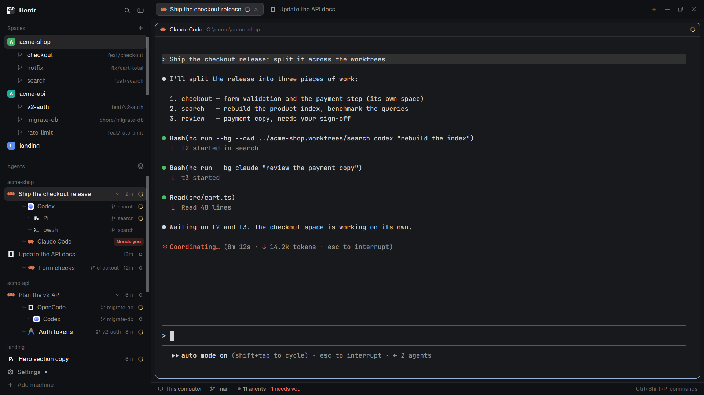

# huajar-worktrees

A [Herdr](https://herdr.dev) layout: Herdr's default window with git worktrees nested under their repo, in both the Spaces sidebar and the Agents list. Worktrees without a space show dimmed, one click away. Agent tabs and rows show the session's title instead of a number.

## Install

Ask your agent in Herdr:

> Add the layout at https://github.com/huajar/huajar-worktrees

It copies `layouts/huajar-worktrees.json` and `mods/huajar-spaces/`, `mods/huajar-agents/`, `mods/huajar-tabs/` into `~/.config/herdr-app/`, checks them and switches to the layout. `ctrl-shift-l` switches back; deleting those files removes it.

`huajar-spaces` and `huajar-agents` run `git` (`rev-parse`, `status`, `worktree list`) in your spaces' folders. They use no network and read no other files.

How it's built, and how to rebuild it after a Herdr update: [RECIPE.md](RECIPE.md).

## License

Apache 2.0. The three mods are modified copies of Herdr's shipped `spaces`, `agents` and `tabs` mods (version 0.1.11).
