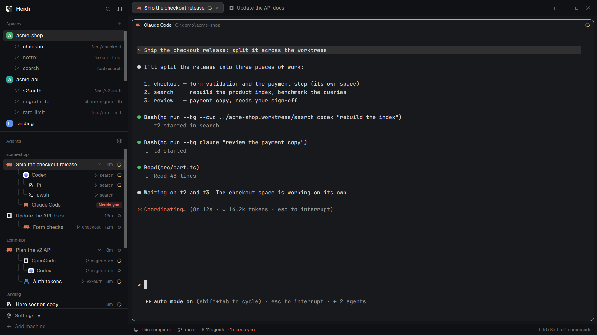

# Huajar Worktrees

Herdr's default window, but git worktrees live under their repo instead of beside it. In the Spaces sidebar each repo's space lists every one of its worktrees nested underneath: the ones with a space of their own, and, dimmed, the ones nobody opened yet. In the Agents list a worktree's agents join their repo's group, hang from the repo's last agent like sub-agents, and carry a small branch tag with the worktree's name. Agent rows, and the tabs agents run in, read the session's own title instead of a program name or a tab number.

## What you see

The same regions as Herdr's `main` layout, unchanged in size, color and type: a 268px sidebar (`chrome` background) with the title bar, Spaces and Agents stacked, a status line at the bottom; on the right the tab bar, the active tab's panes as 10px-radius cards with a 30px header, and the hidden Files/Changes panel. Only the two sidebar lists and the tab labels differ.

**Spaces** (`huajar-spaces`), under each repo's space, after any nested worktree spaces (the shipped behavior):
- One row per worktree from `git worktree list` that no open space is in. Row height 28px, 8px radius, hover `hover`.
- A 13px `branch.svg` icon in `dim`, indented 22px; the worktree folder's name in `muted` (max 150px, truncated); its branch right-aligned at 11.5px in `dim`, only when it differs from the folder name.
- The tree connector (`├─` / `└─`) covers both kinds, so the last row closes the branch whether it's a space or a dimmed worktree.
- Bare repos and the main checkout are never listed as worktrees.

**Agents** (`huajar-agents`):
- In "Grouped by space" a worktree space's agents are not a group of their own: they join the group of the space opened in the repo's main checkout, and the header is that space's name.
- They are drawn after that space's last own agent, at sub-agent depth, with the same rounded tree line (1.5px `input` border, bottom-left radius 6), indented 39px. If the repo space has no agent of its own, they stand alone in the group.
- Their row shows a tag after the name: an 11px `branch.svg` and the worktree space's name, 11px, `dim`, max 90px, truncated.
- A sub-agent whose live folder is a linked worktree shows the same tag with the worktree folder's name.
- Row text: a tab you named wins; otherwise the agent's title, cleaned (see Built from); otherwise Herdr's label.
- "Sorted by status" (the priority view) is unchanged.

**Tabs** (`huajar-tabs`): a tab with an agent is labeled with the same text as its Agents row: the name you gave the tab, else the session's cleaned title ("Ship the checkout release"), else the number as before. Shells and other programs keep the number. Same 170px max width, truncated; icon, spinner, status dot, close button, drag to reorder and double-click to rename are unchanged.

## How it behaves

- **Agent status** (working, blocked, done, idle) looks exactly as in the shipped `agents` mod: the same dots, spinner, "Needs you" pill, sections and sounds. A worktree group's status is its repo group's, the most urgent of all its rows.
- **Clicking a dimmed worktree** goes to the agent working in it: a live terminal whose folder is that worktree or inside it, preferring one running an agent. It focuses that terminal's pane, or peeks at it if it's a sub-agent without a pane. With no terminal there, it runs `space.new { folder }` on the space's machine, and the row turns into a nested worktree space.
- **Adding or removing a worktree** (`git worktree add/remove`, from anywhere) shows within about a second: the shipped `.git` folder watch wakes the check. On another machine, where folders can't be watched, the shipped 60s refresh picks it up.
- **The narrow rail** (sidebar under 160px) leaves dimmed worktrees out; spaces are drawn as the shipped mod draws them.
- **Closing the repo's main space** turns its worktree spaces back into ordinary top-level spaces in both lists; reopening it nests them again.
- Clicks, keys, drag-to-reorder, folding groups, the sort menu and the context menus are the shipped mods', unchanged.

## Built from

- `layouts/huajar-worktrees.json`: `layout.clone` of `main` (0.1.11). Only three `content.mod` values change: the `spaces` block points to `huajar-spaces`, the `agents` block to `huajar-agents`, the `tabs` block to `huajar-tabs`. Everything else (`workspace-chrome`, `pane`, `files`, `changes`, `workspace-status`) is shipped.
- `mods/huajar-spaces/`: `mod.clone` of `spaces`.
  - Adds a `wts` map: repo key, then the parsed worktrees.
  - In the shipped `check()`, only when the place is a repo's main checkout (not `linked`), it runs `git worktree list --porcelain` and parses it. It skips the first block (the main checkout) and bare entries, and keeps `{path, branch}`.
  - It also stores `top` (the `--show-toplevel` result) in each place's info.
  - In `ordered()`, after a repo space's nested worktree spaces, it appends `{ghost}` rows for worktrees whose normalized path (backslashes to `/`, no trailing `/`, lowercase) matches no open space's `top`.
  - `render()` filters ghosts out when collapsed and draws them with `ghostRow()`. A click calls `openGhost()`, which uses `terminals()`, `panes()`, `pane.focus`, `terminal.peek` and `space.new`.
- `mods/huajar-agents/`: `mod.clone` of `agents`.
  - `gitOf(folder, machine)` caches one `git rev-parse --path-format=absolute --show-toplevel --git-common-dir` per folder. It asks once in `cx.spawn` and answers later. `linked` means the common dir isn't `<top>/.git`.
  - `homes()` maps each space id to the space in its repo's main checkout, or to itself. It takes a space's folder from its first terminal's live `cwd`, else `space.folder`.
  - Grouping and sorting use that home space. `groupRows()` splits a group into own agents and worktree agents, and `withKids(a, i, extra, line)` draws the worktree agents as the last branches of the last own agent.
  - `sessionTitle(title, program, spaceName)`:
    - It strips leading glyphs (Claude's `✳`).
    - Up to 3 times, it drops a leading program name or space name followed by `·`, `|`, `»`, `: ` or ` - `.
    - It drops pi's `π`.
    - Up to 3 times, it drops a trailing space name or path.
    - It returns null for an empty result, a bare program name, a path, or text with `@`.
  - The sort-menu popup opens `huajar-agents`, its own name.
- `mods/huajar-tabs/`: `mod.clone` of `tabs`, with its own `win-*.svg` window buttons. A copy of `huajar-agents`' `sessionTitle`; the label is `c.named ? c.name : sessionTitle(agentPane.title, agentPane.program, space.name)`, falling back to the shipped label. `agentPane` is the tab's first pane in `panes()` with `program.agent`.
- `huajar-spaces` and `huajar-agents` run **`git`** through `exec`, on the space's machine. They don't use the network, read no files, and add no timers: the shipped 250ms/15s/30s timers and the `.git` watch are all they use.
- Icon: `mods/workspace-chrome/branch.svg`, shipped with Herdr.
- `layouts/huajar-worktrees.svg`: the Settings thumbnail (`"preview"` on the layout root), a 320x200 sketch of the window in the graphite colors.

## Watch out

- `sessionTitle` lives in both `huajar-agents` and `huajar-tabs` (mods can't import each other's files): change both together, or tabs and rows disagree.
- Shipped mods and layouts are read-only: clone them, never edit them in place. Clones are never updated, so after a Herdr update re-clone `spaces`, `agents` and `tabs` and re-apply the changes above.
- The `.git` watch does fire on `git worktree add/remove`; a timer poll for it is unnecessary.
- Ask `git worktree list` only from the main checkout's space; a worktree space asking duplicates the work.
- Compare paths normalized: Windows `cwd`s use backslashes and mixed case, `git` prints forward slashes.
- A mod clone's self-opening overlay must use its new name (`openOverlay({ mod: "huajar-agents" })`), or the sort menu opens the shipped mod.
- `setShared` inside `render()` doesn't apply; use it from `init` or async code.
- Worktree spaces nest only under a space opened in the repo's main checkout. Without one, they're plain spaces, as in the shipped mod.
- A remote machine that's away when an agent's folder is first seen leaves that folder untagged until the mod reloads.

## Done when

- `herdr-app check` passes for `mods/huajar-spaces` and `mods/huajar-agents`, and `herdr-app status` shows `"errors": []` with `"layout": "huajar-worktrees"`.
- With a space in a repo's main checkout, `git worktree add ../wt-x` shows a dimmed `wt-x` row under it within a few seconds, and `git worktree remove ../wt-x` removes it.
- Clicking that dimmed row with no terminal in it opens a new space in `wt-x`, which then shows nested (not dimmed) under the repo's space.
- An agent started in the worktree space appears in Agents inside the repo's group, below the repo's own agent, with a `wt-x` branch tag, and not as a `wt-x` group.
- A sub-agent started with `hc run` inside a linked worktree shows the worktree's name as a tag.
- The tab of an agent whose title is "✳ Ship the checkout release" reads "Ship the checkout release" in the tab bar and in Agents; renaming the tab changes both; a plain shell tab still reads its number.
- Closing the repo's main space makes `wt-x` a top-level space in Spaces and its own group in Agents.
